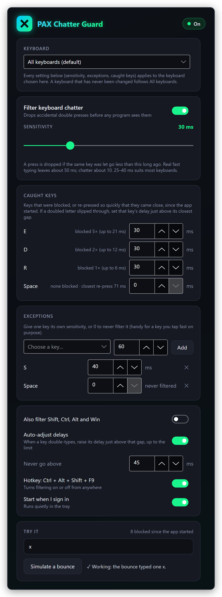

# PAX Chatter Guard

**Stops a worn mechanical keyboard from typing double letters.** A small tray app that catches key chatter (one press that the switch reports as two) and drops the extra press before any program sees it.

<p align="center">
  
</p>

When a key goes down again only a few milliseconds after it was released, that is almost never a person: real fast typing leaves about 50 ms between letting go of a key and pressing it again, while a bouncing switch does it in about 10. PAX Chatter Guard sits between the keyboard and everything else and throws away presses that come back too soon.

## Features

- **One sensitivity for every key.** The default is 30 ms; 25 to 40 ms suits most keyboards.
- **Per-key exceptions.** Give the key that chatters worst a longer delay, or set a key to 0 so it is never filtered (handy for a key you double-tap on purpose in games).
- **Caught keys.** The window lists every key it blocked since it started, how many times, the longest gap it blocked, and re-presses that came close. You can raise a key's delay right there.
- **Per-keyboard settings (Windows).** Every keyboard it sees typing gets an entry. Change one and it gets its own sensitivity and exceptions; switch one off and that keyboard is left alone. The others follow the defaults.
- **Auto-adjust (optional).** When the same key is re-pressed faster than the limit you set (45 ms by default) a second time, its delay is raised to just above that gap, never past the limit.
- **Hotkey:** <kbd>Ctrl</kbd> + <kbd>Alt</kbd> + <kbd>Shift</kbd> + <kbd>F9</kbd> turns filtering on and off from anywhere (not on macOS).
- **Built-in test.** "Simulate a bounce" sends a fake chatter burst through the real filter and tells you whether it was caught.
- **Leaves other input alone.** Keystrokes that programs create (macros, remote desktop, on-screen keyboards) pass through untouched.
- **Light.** The settings window only exists while it is open. Sitting in the tray it uses about 13 MB of memory and no CPU while you aren't typing.
- **Start when I sign in**, optional.

| One keyboard with its own settings | The whole window |
| --- | --- |
|  |  |

## How it works

Every key press and release goes through one rule engine (`Core/ChatterEngine.cs`), the same on every system:

1. When a key is released, the time is noted.
2. When the same key is pressed again, the gap since that release is compared with the key's delay: its exception if it has one, otherwise the sensitivity of the keyboard it came from, otherwise the default.
3. If the gap is shorter, the press **and its matching release** are dropped, so programs never see half a keystroke. Holding a key down (auto-repeat) is never affected.

Keys are stored by physical position (PS/2 scancodes), so an exception for the key right of Caps Lock means the same key on every layout and every operating system.

Each system has its own way to catch keystrokes before programs get them:

| System | How keys are caught |
| --- | --- |
| Windows | A low-level keyboard hook (`WH_KEYBOARD_LL`) on its own high-priority thread, with a watchdog that reinstalls the hook if Windows drops it. Raw Input tells it which keyboard is typing. |
| Linux | Takes exclusive hold of each keyboard (`/dev/input/event*`, `EVIOCGRAB`) and re-sends the keys that pass through a virtual keyboard created with `uinput`. Works under X11, Wayland and on the text console. |
| macOS | A Quartz event tap (`CGEventTap`) on key-down and key-up events. |

## Supported systems

Only the Windows version has been used on real hardware so far. The Linux and macOS versions are built from the same code and offered so people can try them, but **nobody has tested them yet**. Reports, good or bad, are welcome in the issues.

| System | Status | Notes |
| --- | --- | --- |
| Windows 11, x64 | **Tested** | In daily use. |
| Windows 10, x64 | Should work, untested | Same build as Windows 11. |
| Linux x64 (X11, Wayland, console) | **Builds, untested** | Needs the permissions below. You choose which keyboards to filter from a tick list; per-keyboard sensitivity is Windows only. |
| macOS, Apple Silicon (arm64) | **Builds, untested** | Needs the Accessibility permission. Shift, Ctrl, Option and Cmd are never filtered, and the on/off hotkey isn't available (use the tray menu). Not signed or notarised. |
| macOS, Intel (x64) | **Builds, untested** | As above. |
| Windows or Linux on Arm | No download | May build from source with `-r win-arm64` or `-r linux-arm64`; untested. |

## Install

Download from **[the latest release](https://github.com/joshpack/PaxChatterGuard/releases/latest)**. Every file has a `.sha256` next to it for checking the download.

| File | For |
| --- | --- |
| `PaxChatterGuard-1.0.0-win-x64.zip` | Windows 10/11, 64-bit. Needs the .NET 10 Runtime. |
| `PaxChatterGuard-1.0.0-linux-x64.tar.gz` | Linux, 64-bit. **Untested.** Self-contained, nothing else to install. |
| `PaxChatterGuard-1.0.0-osx-arm64.tar.gz` | Mac with Apple Silicon. **Untested.** Self-contained. |
| `PaxChatterGuard-1.0.0-osx-x64.tar.gz` | Mac with an Intel processor. **Untested.** Self-contained. |

### Windows

1. Install the **[.NET 10 Runtime](https://dotnet.microsoft.com/download/dotnet/10.0)** (x64) if you don't have it. The plain ".NET Runtime" is enough; the ".NET Desktop Runtime" includes it, so that works too.
2. Unzip `PaxChatterGuard-1.0.0-win-x64.zip` somewhere permanent, for example `%LOCALAPPDATA%\PaxChatterGuard`.
3. Run `PaxChatterGuard.exe`. It doesn't need administrator rights.

The exe isn't code-signed, so SmartScreen may warn the first time: choose **More info → Run anyway**. To check the download in PowerShell: `Get-FileHash PaxChatterGuard-1.0.0-win-x64.zip` and compare it with the `.sha256` file.

### Linux (untested)

```bash
sha256sum -c PaxChatterGuard-1.0.0-linux-x64.tar.gz.sha256
mkdir -p ~/.local/opt
tar -xzf PaxChatterGuard-1.0.0-linux-x64.tar.gz -C ~/.local/opt
~/.local/opt/PaxChatterGuard/PaxChatterGuard
```

**Permissions.** The filter has to read your keyboards and create a virtual one, which ordinary users can't do by default. Run these once, then log out and back in:

```bash
# 1. Read keyboards: join the input group
sudo usermod -aG input $USER

# 2. Let that group create the virtual keyboard
echo 'KERNEL=="uinput", GROUP="input", MODE="0660"' | sudo tee /etc/udev/rules.d/99-uinput.rules

# 3. Load the uinput module now and at every boot
echo uinput | sudo tee /etc/modules-load.d/uinput.conf
sudo modprobe uinput
```

If anything is missing, the window shows a **Needs attention** card with these same steps and a **Retry** button. Being in the `input` group lets any program you run read your keystrokes, so only do this on a computer you trust.

The tray icon uses the StatusNotifier (AppIndicator) standard. KDE, Xfce, Cinnamon and most others show it; GNOME needs the *AppIndicator and KStatusNotifierItem Support* extension. The usual libraries for X11 apps (`libX11`, `libICE`, `libSM`, `fontconfig`) need to be present; desktop installs normally have them.

### macOS (untested)

```bash
shasum -a 256 -c PaxChatterGuard-1.0.0-osx-arm64.tar.gz.sha256
mkdir -p ~/Applications
tar -xzf PaxChatterGuard-1.0.0-osx-arm64.tar.gz -C ~/Applications
xattr -dr com.apple.quarantine ~/Applications/PaxChatterGuard   # it isn't signed or notarised
~/Applications/PaxChatterGuard/PaxChatterGuard
```

Use the `osx-x64` file on an Intel Mac.

**Permissions.** macOS only lets an app filter the keyboard after you allow it. Open **System Settings → Privacy & Security → Accessibility** and switch on PAX Chatter Guard. When you start it from Terminal, macOS may list **Terminal** instead; switch that on. Then press **Retry** in the app's window. If macOS also asks for **Input Monitoring**, allow that too.

This download is a plain folder, not a signed `.app` bundle, so expect rough edges on macOS.

## First run

- The settings window opens and a tray icon appears (an X on a green tile; it dims while filtering is off).
- **Click the tray icon** to open the settings. **Right-click** it for *Settings…*, *Filtering* (on/off) and *Quit*.
- Closing the window keeps the filter running in the tray. *Quit* stops it.
- Type normally for a while, then look at **Caught keys** to see what has been blocked.
- Switch on **Start when I sign in** to start with the system. It then starts quietly in the tray (`--minimized`) and only opens the window when something needs attention.

| System | What "Start when I sign in" adds |
| --- | --- |
| Windows | `HKCU\Software\Microsoft\Windows\CurrentVersion\Run`, value `PaxChatterGuard` |
| Linux | `~/.config/autostart/pax-chatter-guard.desktop` |
| macOS | `~/Library/LaunchAgents/com.paxchatterguard.app.plist` |

### Choosing a sensitivity

Start at 30 ms. If a letter still doubles now and then, find it under **Caught keys** and set that key's delay just above its "closest let through" gap, or turn on **Auto-adjust**. If quick double-taps (in games, say) go missing, lower the sensitivity or give that key an exception of 0.

## Hotkey and command line

| Hotkey | What it does |
| --- | --- |
| <kbd>Ctrl</kbd> + <kbd>Alt</kbd> + <kbd>Shift</kbd> + <kbd>F9</kbd> | Filtering on/off. Can be switched off in the settings. Not available on macOS. |

| Option | What it does |
| --- | --- |
| `--minimized` | Start in the tray without opening the window (used by "Start when I sign in"). |
| `--safe-test N` | Quit by itself after *N* seconds. Meant for testing changes to the filter, so a mistake can never leave a broken filter on your keyboard. |

Only one copy runs at a time; starting a second one while the first is running does nothing.

## Settings file

Everything you change is saved as JSON:

| System | File |
| --- | --- |
| Windows | `%APPDATA%\PaxChatterGuard\settings.json` |
| Linux | `~/.config/PaxChatterGuard/settings.json` (or under `$XDG_CONFIG_HOME`) |
| macOS | `~/.config/PaxChatterGuard/settings.json` |

Main fields: `Enabled`, `GlobalMs` (the sensitivity), `Rules` (scancode → ms, 0 = never filter), `FilterModifiers`, `HotkeyEnabled`, `AutoAdjust`, `AutoMaxMs`, `Devices` (per-keyboard settings, Windows) and `LinuxDevices` (keyboards to filter on Linux; empty means all). Delete the file to go back to the defaults. The caught-keys list lives in memory only and is never saved.

## Uninstall

1. In the settings, switch off **Start when I sign in** (removes the startup entry listed above).
2. Right-click the tray icon → **Quit**.
3. Delete the folder you unpacked it to, and the settings folder listed above.
4. Linux, if you want them gone too: `sudo rm /etc/udev/rules.d/99-uinput.rules /etc/modules-load.d/uinput.conf` and `sudo gpasswd -d $USER input`.
5. macOS: remove the entry from **Privacy & Security → Accessibility**.

## Build from source

Needs the [.NET 10 SDK](https://dotnet.microsoft.com/download/dotnet/10.0).

```bash
git clone https://github.com/joshpack/PaxChatterGuard.git
cd PaxChatterGuard
dotnet run -- --safe-test 60          # try it; quits by itself after a minute

# Windows (framework-dependent: needs the .NET 10 Runtime)
dotnet publish -c Release -r win-x64 --self-contained false -p:Version=1.0.0 -p:DebugType=none -o publish/win-x64

# Linux and macOS (self-contained)
dotnet publish -c Release -r linux-x64 --self-contained true -p:Version=1.0.0 -p:DebugType=none -o publish/linux-x64
dotnet publish -c Release -r osx-arm64 --self-contained true -p:Version=1.0.0 -p:DebugType=none -o publish/osx-arm64
dotnet publish -c Release -r osx-x64   --self-contained true -p:Version=1.0.0 -p:DebugType=none -o publish/osx-x64
```

Every target can be built on any of the three systems. If the project sits on a network drive whose clock differs from yours, build with `--no-incremental` so no change is skipped.

For automated tests, the environment variable `PAXCG_ACCEPT_INJECTED=1` makes keystrokes created by test tools count as real ones.

## Code layout

| Path | What's there |
| --- | --- |
| `Program.cs` | Start-up, command-line options, single-instance lock |
| `App.axaml(.cs)` | Theme, tray icon and menu; creates the window when needed and frees it when closed |
| `Core/ChatterEngine.cs` | The filtering rules, caught-key stats, auto-adjust and the on/off hotkey |
| `Core/KeyCatalog.cs` | Key names by scancode |
| `Platform/IKeyboardBackend.cs` | The interface each system implements, and the factory that picks one |
| `Platform/WindowsBackend.cs` | Low-level hook, Raw Input keyboard detection, watchdog |
| `Platform/LinuxBackend.cs` | evdev grab and uinput virtual keyboard |
| `Platform/MacBackend.cs` | Quartz event tap |
| `Platform/MemoryTrim.cs` | Hands unused memory back to the system after the window closes |
| `Services/GuardService.cs` | Ties settings, engine and backend together |
| `Services/GuardSettings.cs` | The settings file |
| `Services/Autostart.cs` | Start at sign-in on each system |
| `Views/SettingsWindow.axaml(.cs)` | The settings window |
| `SpadeIcon.cs` | The app and tray icon, drawn in code |
| `docs/screenshots/` | The pictures in this file |

Built with [Avalonia](https://avaloniaui.net/) 12 on .NET 10.
