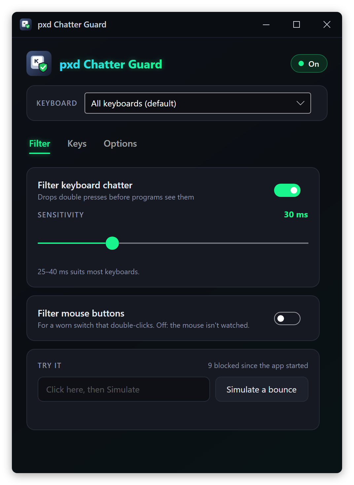
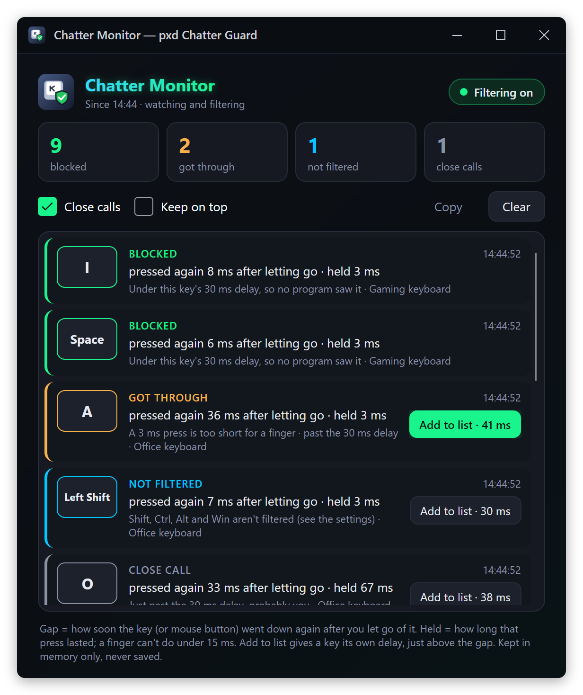
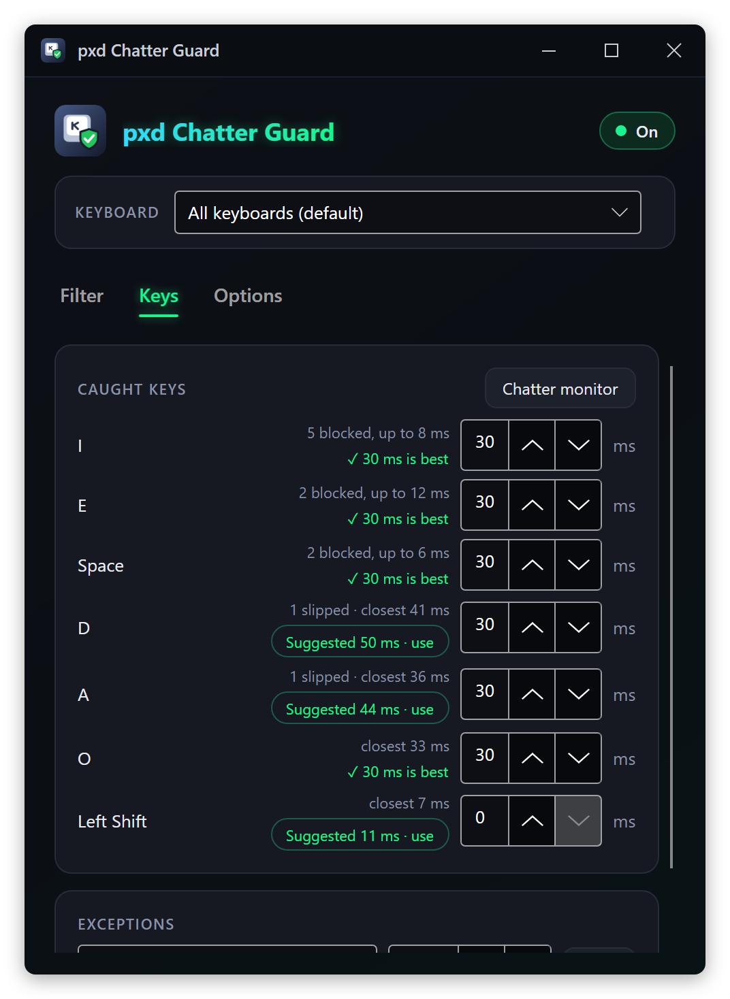
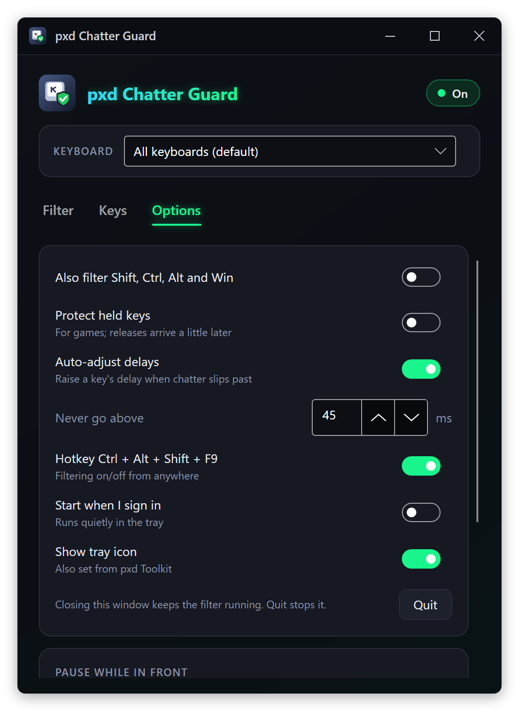
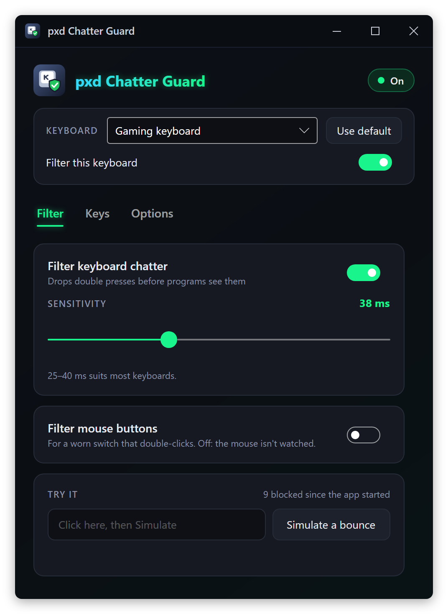

# pxd Chatter Guard

**Stops a worn mechanical keyboard from typing double letters.** A small tray app that catches key chatter (one press that the switch reports as two) and drops the extra press before any program sees it.

<p align="center">
  
</p>

When a key goes down again only a few milliseconds after it was released, that is almost never a person: real fast typing leaves about 50 ms between letting go of a key and pressing it again, while a bouncing switch does it in about 10. pxd Chatter Guard sits between the keyboard and everything else and throws away presses that come back too soon.

## Features

- **One sensitivity for every key.** The default is 30 ms; 25 to 40 ms suits most keyboards.
- **Per-key exceptions.** Give the key that chatters worst a longer delay, or set a key to 0 so it is never filtered (handy for a key you double-tap on purpose in games).
- **Chatter monitor.** A live list of every press that looked like chatter, blocked or not: the key, how soon it went down again after you let go, how long the press lasted, and what happened to it. Chatter that got through is flagged so you can compare it with what you saw on screen, and one click (**Add to list**) gives that key its own delay just above the gap. A blocked press you made on purpose has **Was me**, which lowers the delay below it. It keeps watching with filtering off too, so you can see what the filter *would* catch before switching it on. Open it from the tray menu or the settings.
- **Caught keys, with a suggested delay for each.** The settings list every key it blocked since it started, how many times, the longest gap it blocked, chatter that got through, and re-presses that came close. Each key also gets a **suggested delay** worked out from what that key has done: high enough to clear the longest chatter seen on it (plus 20%, at least 4 ms), low enough to let your own quick re-presses of it through (3 ms under the second-quickest, so one fluke never lowers it). It only moves away from the key's current delay when the data says so, and one click uses it. Hover over it to see why.
- **Per-keyboard settings (Windows).** Every keyboard it sees typing gets an entry. Change one and it gets its own sensitivity and exceptions; switch one off and that keyboard is left alone. The others follow the defaults.
- **Auto-adjust (optional).** When chatter gets past a key's delay a second time (a press too short for a finger, sooner than the limit you set, 45 ms by default), that key's delay is raised to just above the gap, never past the limit. Quick double taps you make on purpose never count.
- **Held keys keep working.** If a press is blocked but you are actually holding the key, it is let through as soon as the key starts repeating, so a held key is never lost for good.
- **Protect held keys (optional, Windows).** For games: every release of a filtered key is held back by its delay, and if the switch bounces back down in that time the bounce is swallowed, so programs see the key stay down instead of a release and a missing press. A held movement key never stutters. The cost is that letting go of a key reaches programs that many milliseconds later. It is new in 1.1.0 and off by default. With mouse buttons filtered it covers them too: a held button or a drag can't let go by itself (drag chatter), while a click's release still goes out the moment the pointer moves, so a click never turns into a short drag.
- **Mouse buttons too (optional, Windows).** Switch on **Also filter mouse buttons** and a worn mouse switch can't double-click either: a click that comes back sooner than the mouse delay after letting go of the same button is dropped, together with its release. The mouse delay is a setting of its own, 50 ms to start with. Left, right, middle and the two side buttons (back and forward) work like keys: each can have its own exception, and they show up in the chatter monitor and under caught keys with a suggested delay. Clicks that programs create are left alone, and so are taps on a touch screen or with a pen. While it is off, which is the default, the mouse isn't watched at all. New in 1.2.0, and so far tried only by the engine tests, not yet on a real worn mouse.
- **Pause for chosen programs (Windows).** Filtering pauses while a program on your list is in front, for example a game where you double-tap on purpose. The monitor still watches.
- **Says when a program is out of reach (Windows).** Windows doesn't let a program without administrator rights see the keys typed into one that runs as administrator. While such a program is in front, the status and tray tooltip say *Not filtering in game.exe (runs as administrator)* instead of failing quietly, and the settings offer **Restart as administrator**. See [Programs that run as administrator](#programs-that-run-as-administrator).
- **Security keys are left alone.** A YubiKey types its codes as a keyboard, repeating letters a few milliseconds apart, which looks exactly like chatter. Yubico keys are never filtered unless you give them settings of their own.
- **Hotkey:** <kbd>Ctrl</kbd> + <kbd>Alt</kbd> + <kbd>Shift</kbd> + <kbd>F9</kbd> turns filtering on and off from anywhere (not on macOS).
- **Built-in test.** "Simulate a bounce" sends a fake chatter burst through the real filter and tells you whether it was caught.
- **Leaves other input alone.** Keystrokes that programs create (macros, remote desktop, on-screen keyboards, input methods) pass through untouched.
- **Light.** The windows only exist while they are open. Sitting in the tray it uses about 13 MB of memory and no CPU while you aren't typing (or, with mouse buttons filtered, using the mouse). The monitor's log is a small fixed buffer in memory that is never saved.
- **Start when I sign in**, optional. Running as administrator, it starts as administrator at sign-in too, without Windows asking each time.
- **Works with [pxd Toolkit](https://github.com/joshpack/pxdToolkit).** Its tray icon can be turned off and on there (or with **Show tray icon** in the settings; both stay in sync). With the icon hidden the filter keeps running, and starting the app again, or opening it from pxd Toolkit, brings the window back. Every window has the same dark pxd title bar and opens where you last left it, at the same size.

<p align="center">
  
</p>

The settings have three tabs: **Filter** (on/off, sensitivity, mouse buttons, the test), **Keys** (caught keys with their suggested delays, and exceptions) and **Options** (everything else). The keyboard picker above them applies to all three. Hover over a setting for the details.

| Keys tab | Options tab | One keyboard with its own settings |
| --- | --- | --- |
|  |  |  |

## How it works

Every key press and release goes through one rule engine (`Core/ChatterEngine.cs`), the same on every system:

1. When a key is released, the time is noted.
2. When the same key is pressed again, the gap since that release is compared with the key's delay: its exception if it has one, otherwise the sensitivity of the keyboard it came from, otherwise the default.
3. If the gap is shorter, the press **and its matching release** are dropped, so programs never see half a keystroke. Holding a key down (auto-repeat) is never affected.
4. If a dropped press turns out to be held (the key starts repeating), it was a finger, not a bounce: from then on the key is let through as if just pressed, and its release with it.

With **Protect held keys** on, step 3 works the other way round, like the "defer release" debounce in keyboard firmware: the release is held back for the key's delay. A press that comes back within it is a bounce and is swallowed, so programs saw the key stay down the whole time. Otherwise the release is sent when the delay runs out, with the key's own virtual-key code, scan code and extended flag, so it matches the press exactly. Releases are timed on a high-resolution timer. Any release still waiting is sent when the app quits, so no key is left down. Caps Lock, Num Lock and Scroll Lock are never held back.

Mouse buttons go through the same engine, each with a code of its own (above any scancode) and the mouse delay instead of the keyboard's sensitivity. They never auto-repeat, so step 4 doesn't apply to them. With **Protect held keys** on, a held-back button release is sent with `SendInput` the same way a key's is (when the buttons are swapped in the system settings, the other physical button is sent, because Windows swaps sent clicks as well). The pointer matters too. A press that moved further than the system's drag distance (4 pixels by default) is a drag: its release is held back in full while the pointer keeps moving, so a bounce mid-drag can't drop what's being dragged. A click that stayed on its spot is different: once the pointer moves more than half the drag distance away, its held-back release is sent at once, and that movement waits for it (a millisecond or so), so programs see the click end before the pointer moves on.

The chatter monitor uses one more clue. A bouncing contact makes a "press" that lasts one to five milliseconds, and nobody can press and release a key in under about 15 ms. So a quick re-press (within 100 ms) where either press was that short is reported as chatter that **got through**, even when the gap was longer than the delay. Re-presses up to 20 ms past the delay are reported as **close calls**, which are usually you. Only presses that can't be a finger teach auto-adjust anything.

Keys are stored by physical position (PS/2 scancodes), so an exception for the key right of Caps Lock means the same key on every layout and every operating system.

Each system has its own way to catch keystrokes before programs get them:

| System | How keys are caught |
| --- | --- |
| Windows | A low-level keyboard hook (`WH_KEYBOARD_LL`) on its own high-priority thread, with a watchdog that reinstalls the hook if Windows drops it. Raw Input tells it which keyboard is typing. With mouse buttons filtered, a low-level mouse hook (`WH_MOUSE_LL`) runs on the same thread: movement and the wheel pass straight through, and the watchdog replaces the mouse hook whenever it reinstalls the keyboard hook, or when nothing came through the mouse hook for 30 seconds. |
| Linux | Takes exclusive hold of each keyboard (`/dev/input/event*`, `EVIOCGRAB`) and re-sends the keys that pass through a virtual keyboard created with `uinput`. Works under X11, Wayland and on the text console. |
| macOS | A Quartz event tap (`CGEventTap`) on key-down and key-up events. |

## Supported systems

Only the Windows version has been used on real hardware so far. The Linux and macOS versions are built from the same code and offered so people can try them, but **nobody has tested them yet**. Reports, good or bad, are welcome in the issues.

| System | Status | Notes |
| --- | --- | --- |
| Windows 11, x64 | **Tested** | In daily use. Programs that run as administrator are only filtered while pxd Chatter Guard runs as administrator too ([below](#programs-that-run-as-administrator)). |
| Windows 10, x64 | Should work, untested | Same build as Windows 11, same note about programs that run as administrator. |
| Linux x64 (X11, Wayland, console) | **Builds, untested** | Needs the permissions below. You choose which keyboards to filter from a tick list; per-keyboard sensitivity is Windows only. |
| macOS, Apple Silicon (arm64) | **Builds, untested** | Needs the Accessibility permission. Shift, Ctrl, Option and Cmd are never filtered, and the on/off hotkey isn't available (use the tray menu). Not signed or notarised. |
| macOS, Intel (x64) | **Builds, untested** | As above. |
| Windows or Linux on Arm | No download | May build from source with `-r win-arm64` or `-r linux-arm64`; untested. |

### Programs that run as administrator

Windows keeps programs apart by their rights (User Interface Privilege Isolation): a program without administrator rights can't see the keys typed into a program that runs as administrator, and a low-level keyboard hook is no exception. pxd Chatter Guard normally runs without those rights, so while a program that runs as administrator is in front (some games and their launchers, Task Manager, Registry Editor, an administrator command prompt), nothing typed into it reaches the filter. The chatter monitor sees nothing there either, and the on/off hotkey doesn't work. With mouse buttons filtered, clicks on such a program's windows are out of reach in the same way.

When that happens, the app says so instead of failing quietly:

- The status in the settings and the chatter monitor reads **Not filtering in game.exe**, the tray tooltip *Not filtering in game.exe (runs as administrator)*, and the tray icon dims, as it does when filtering is off.
- The settings name the program and offer **Restart as administrator** (it's in the tray menu too). Windows asks first; the new copy then filters every program.

To have it start as administrator every time, restart it as administrator, then switch on **Start when I sign in** (or, if it was already on, press **Start as administrator instead** below it). Instead of the Run key it then registers a scheduled task that starts it with highest privileges when you sign in, so Windows doesn't ask each time. Switching it off removes the task and the Run entry; doing that from a copy that isn't running as administrator makes Windows ask first.

Two things to keep in mind:

- A program that starts as administrator without asking can be swapped out to get those rights: anything that can change the files in its folder could then run as administrator at your next sign-in. If you use this, keep the app in a folder only administrators can change, such as `C:\Program Files\pxdChatterGuard`, not under your user folder.
- If your Windows account isn't an administrator, Windows asks for an administrator's password, and that copy runs as the administrator's account, with that account's settings.

Whether a program runs as administrator is read from its access token. A program Windows won't let it look into at all (one of the system's, or another account's) is taken to run as administrator too.

## Install

Download from **[the latest release](https://github.com/joshpack/pxdChatterGuard/releases/latest)**. Every file has a `.sha256` next to it for checking the download.

| File | For |
| --- | --- |
| `pxdChatterGuard-1.4.0-win-x64.zip` | Windows 10/11, 64-bit. Needs the .NET 10 Runtime. |
| `pxdChatterGuard-1.4.0-linux-x64.tar.gz` | Linux, 64-bit. **Untested.** Self-contained, nothing else to install. |
| `pxdChatterGuard-1.4.0-osx-arm64.tar.gz` | Mac with Apple Silicon. **Untested.** Self-contained. |
| `pxdChatterGuard-1.4.0-osx-x64.tar.gz` | Mac with an Intel processor. **Untested.** Self-contained. |

### Windows

1. Install the **[.NET 10 Runtime](https://dotnet.microsoft.com/download/dotnet/10.0)** (x64) if you don't have it. The plain ".NET Runtime" is enough; the ".NET Desktop Runtime" includes it, so that works too.
2. Unzip `pxdChatterGuard-1.4.0-win-x64.zip` somewhere permanent, for example into `%LOCALAPPDATA%`. It contains one folder, `pxdChatterGuard`. To update, quit the app and replace that folder; your settings live elsewhere and are kept.
3. Run `pxdChatterGuard.exe` from that folder. It doesn't need administrator rights, except to filter programs that themselves run as administrator (see [Programs that run as administrator](#programs-that-run-as-administrator)).

The exe isn't code-signed, so SmartScreen may warn the first time: choose **More info → Run anyway**. To check the download in PowerShell: `Get-FileHash pxdChatterGuard-1.4.0-win-x64.zip` and compare it with the `.sha256` file.

### Linux (untested)

```bash
sha256sum -c pxdChatterGuard-1.4.0-linux-x64.tar.gz.sha256
mkdir -p ~/.local/opt
tar -xzf pxdChatterGuard-1.4.0-linux-x64.tar.gz -C ~/.local/opt
~/.local/opt/pxdChatterGuard/pxdChatterGuard
```

**Permissions.** The filter has to read your keyboards and create a virtual one, which ordinary users can't do by default. Run these once, then log out and back in:

```bash
# 1. Read keyboards: join the input group
sudo usermod -aG input $USER

# 2. Let that group create the virtual keyboard
echo 'KERNEL=="uinput", GROUP="input", MODE="0660"' | sudo tee /etc/udev/rules.d/99-uinput.rules

# 3. Load the uinput module now and at every boot
echo uinput | sudo tee /etc/modules-load.d/uinput.conf
sudo modprobe uinput
```

If anything is missing, the window shows a **Needs attention** card with these same steps and a **Retry** button. Being in the `input` group lets any program you run read your keystrokes, so only do this on a computer you trust.

The tray icon uses the StatusNotifier (AppIndicator) standard. KDE, Xfce, Cinnamon and most others show it; GNOME needs the *AppIndicator and KStatusNotifierItem Support* extension. The usual libraries for X11 apps (`libX11`, `libICE`, `libSM`, `fontconfig`) need to be present; desktop installs normally have them.

### macOS (untested)

```bash
shasum -a 256 -c pxdChatterGuard-1.4.0-osx-arm64.tar.gz.sha256
mkdir -p ~/Applications
tar -xzf pxdChatterGuard-1.4.0-osx-arm64.tar.gz -C ~/Applications
xattr -dr com.apple.quarantine ~/Applications/pxdChatterGuard   # it isn't signed or notarised
~/Applications/pxdChatterGuard/pxdChatterGuard
```

Use the `osx-x64` file on an Intel Mac.

**Permissions.** macOS only lets an app filter the keyboard after you allow it. Open **System Settings → Privacy & Security → Accessibility** and switch on pxd Chatter Guard. When you start it from Terminal, macOS may list **Terminal** instead; switch that on. Then press **Retry** in the app's window. If macOS also asks for **Input Monitoring**, allow that too.

This download is a plain folder, not a signed `.app` bundle, so expect rough edges on macOS.

## First run

- The settings window opens and a tray icon appears (an X on a green tile; it dims while filtering is off).
- **Click the tray icon** to open the settings. **Right-click** it for *Settings…*, *Chatter monitor…*, *Filtering* (on/off), *Restart as administrator* (Windows, while not running as administrator) and *Quit*.
- Closing the window keeps the filter running in the tray. *Quit* (in the tray menu, or at the bottom of the Options tab) stops it.
- Open the **Chatter monitor** and type normally for a while: anything that looks like chatter shows up there, blocked or not.
- Switch on **Start when I sign in** to start with the system. It then starts quietly in the tray (`--minimized`) and only opens the window when something needs attention.

| System | What "Start when I sign in" adds |
| --- | --- |
| Windows | `HKCU\Software\Microsoft\Windows\CurrentVersion\Run`, value `pxdChatterGuard` |
| Windows, running as administrator | A Task Scheduler task, `\pxdChatterGuard`: starts the app with highest privileges (as administrator, no prompt) when you sign in, with no time limit, also on battery. The Run value above is removed, so only one copy starts. |
| Linux | `~/.config/autostart/pxd-chatter-guard.desktop` |
| macOS | `~/Library/LaunchAgents/com.pxdchatterguard.app.plist` |

On Windows, switching it off removes both the Run value and the task, whichever is there.

**Updating from a version before 1.4.0** (the app went by an earlier name then): on its first start, 1.4.0 moves the settings folder and an existing Run value, LaunchAgent or autostart entry to the names above, pointing at the new copy. It never switches starting at sign-in on when it was off. A start-as-administrator task from before 1.4.0 can only be replaced by a copy that runs as administrator, so it stays as it is until the app next runs as administrator (*Restart as administrator* does it), which swaps it for the new task, on or off as it was.

### Choosing a sensitivity

Start at 30 ms. If a letter still doubles now and then, look for it in the **Chatter monitor**: chatter that got through is marked, and **Add to list** gives that key a delay just above the gap it slipped through with. After a while of normal typing, the **suggested delay** next to each key under **Caught keys** takes everything seen on that key into account; press it to use it. (Or set a delay by hand there, or turn on **Auto-adjust**.) If quick double-taps (in games, say) go missing, find them in the monitor as blocked presses and press **Was me**, lower the sensitivity, give that key an exception of 0, or put the game on the pause list.

For mouse buttons, start at the 50 ms mouse delay. If a single click still opens things as if double-clicked, the monitor shows that button's chatter; if your own quick double-clicks go missing, lower the mouse delay or give that button an exception. If a held button lets go by itself in the middle of a drag, turn on **Protect held keys** as well.

Not sure whether to trust the filter yet? Leave filtering off and keep the monitor open for a while: it lists everything the filter *would* have blocked, so you can compare it with what you typed.

## Hotkey and command line

| Hotkey | What it does |
| --- | --- |
| <kbd>Ctrl</kbd> + <kbd>Alt</kbd> + <kbd>Shift</kbd> + <kbd>F9</kbd> | Filtering on/off. Can be switched off in the settings. Not available on macOS. |

| Option | What it does |
| --- | --- |
| `--minimized` | Start in the tray without opening the window (used by "Start when I sign in"). |
| `--safe-test N` | Quit by itself after *N* seconds. Meant for testing changes to the filter, so a mistake can never leave a broken filter on your keyboard. |
| `--restarted` | Used by *Restart as administrator*: waits up to 15 seconds for the copy that is closing to finish, instead of giving up at once. |

Only one copy runs at a time. Starting a second one while the first is running opens the first one's settings window instead (the way back in when its tray icon is hidden).

## Settings file

Everything you change is saved as JSON:

| System | File |
| --- | --- |
| Windows | `%APPDATA%\pxdChatterGuard\settings.json` |
| Linux | `~/.config/pxdChatterGuard/settings.json` (or under `$XDG_CONFIG_HOME`) |
| macOS | `~/.config/pxdChatterGuard/settings.json` |

Main fields: `Enabled`, `GlobalMs` (the sensitivity), `Rules` (scancode → ms, 0 = never filter; mouse buttons are 65537 to 65541: left, right, middle, back, forward), `FilterModifiers`, `HotkeyEnabled`, `AutoAdjust`, `AutoMaxMs` (also the limit for mouse buttons, so raise it above `MouseMs` for auto-adjust to raise a button's delay), `HoldSafe` (protect held keys and buttons, Windows), `FilterMouse` (also filter mouse buttons, Windows), `MouseMs` (the mouse delay), `PausedPrograms` (exe names that pause filtering, Windows), `Devices` (per-keyboard settings, Windows; mouse buttons always follow the defaults) and `LinuxDevices` (keyboards to filter on Linux; empty means all). Delete the file to go back to the defaults. Where each window was left (size, position, maximized) is kept next to it in `windows.json`. The caught-keys list and the chatter monitor's log live in memory only and are never saved.

## Uninstall

1. In the settings, switch off **Start when I sign in** (removes the startup entry or task listed above).
2. Right-click the tray icon → **Quit**.
3. Delete the folder you unpacked it to, and the settings folder listed above.
4. Linux, if you want them gone too: `sudo rm /etc/udev/rules.d/99-uinput.rules /etc/modules-load.d/uinput.conf` and `sudo gpasswd -d $USER input`.
5. macOS: remove the entry from **Privacy & Security → Accessibility**.

## Build from source

Needs the [.NET 10 SDK](https://dotnet.microsoft.com/download/dotnet/10.0).

```bash
git clone https://github.com/joshpack/pxdChatterGuard.git
cd pxdChatterGuard
dotnet run -- --safe-test 60          # try it; quits by itself after a minute

# Windows (framework-dependent: needs the .NET 10 Runtime)
dotnet publish -c Release -r win-x64 --self-contained false -p:Version=1.4.0 -p:DebugType=none -o publish/win-x64

# Linux and macOS (self-contained)
dotnet publish -c Release -r linux-x64 --self-contained true -p:Version=1.4.0 -p:DebugType=none -o publish/linux-x64
dotnet publish -c Release -r osx-arm64 --self-contained true -p:Version=1.4.0 -p:DebugType=none -o publish/osx-arm64
dotnet publish -c Release -r osx-x64   --self-contained true -p:Version=1.4.0 -p:DebugType=none -o publish/osx-x64
```

Every target can be built on any of the three systems. If the project sits on a network drive whose clock differs from yours, build with `--no-incremental` so no change is skipped.

The filter rules have their own tests, which feed made-up key presses and clicks into the engine and never touch a real keyboard or mouse (plus a check of the start-as-administrator task's definition, which registers nothing):

```bash
dotnet run --project tests/EngineTests
```

For automated tests of the whole app, the environment variable `PXDCG_ACCEPT_INJECTED=1` makes keystrokes created by test tools count as real ones, and `PXDCG_DATA_DIR` points the settings file somewhere else so your real settings are never touched.

## Code layout

| Path | What's there |
| --- | --- |
| `Program.cs` | Start-up, command-line options, single-instance lock |
| `App.axaml(.cs)` | Theme, tray icon and menu; creates the windows when needed and frees them when closed |
| `Core/ChatterEngine.cs` | The filtering rules, held-back releases, the chatter log, caught-key stats, auto-adjust and the on/off hotkey |
| `Core/KeyCatalog.cs` | Key names by scancode, and the mouse buttons' codes |
| `Platform/IKeyboardBackend.cs` | The interface each system implements, and the factory that picks one |
| `Platform/WindowsBackend.cs` | Low-level keyboard hook (and mouse hook, with mouse buttons on), Raw Input keyboard detection, watchdog, sending held-back releases |
| `Platform/ForegroundWatcher.cs` | Which program is in front, for the pause list, and whether it runs as administrator (Windows) |
| `Platform/Elevation.cs` | Whether this app or another program runs as administrator, and starting programs as administrator (Windows) |
| `Platform/LinuxBackend.cs` | evdev grab and uinput virtual keyboard |
| `Platform/MacBackend.cs` | Quartz event tap |
| `Platform/MemoryTrim.cs` | Hands unused memory back to the system after the window closes |
| `Services/GuardService.cs` | Ties settings, engine and backend together |
| `Services/GuardSettings.cs` | The settings file |
| `Services/Autostart.cs` | Start at sign-in on each system |
| `Services/SignInTask.cs` | The scheduled task that starts it as administrator at sign-in (Windows) |
| `Views/SettingsWindow.axaml(.cs)` | The settings window |
| `Views/MonitorWindow.axaml(.cs)` | The chatter monitor |
| `Views/Chrome.cs` | Puts the pxd title bar on each window and remembers where it was |
| `pxdStandard.cs` | Shared with the other pxd apps: the title bar, remembered window placement, the pxd Toolkit link (`%APPDATA%\pxd\toolkit.json`), and the one-time move from the app's former name |
| `Services/Migration.cs` | First start after the rename: moves the settings folder and the startup entry or task to the new name |
| `Services/TrayLink.cs` | Shows or hides the tray icon as pxd Toolkit or the settings say, live |
| `Services/SingleInstance.cs` | A second start opens the running copy's window |
| `SpadeIcon.cs` | The app and tray icon, drawn in code |
| `tests/EngineTests/` | Tests for the filter rules, and the sign-in task's definition |
| `docs/screenshots/` | The pictures in this file |

Built with [Avalonia](https://avaloniaui.net/) 12 on .NET 10.
